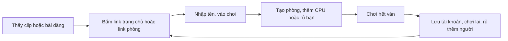

# Campaign Brief: Cờ Cá Ngựa 3D Online – Soft Launch

Ngày lập: 2026-11-21. Trạng thái: đề xuất, chưa duyệt. Mọi con số mục tiêu là **giả định**, chưa có số đo thực.

## 1. Rà soát sản phẩm (từ code và issue, đã kiểm tra)

### Điểm mạnh dùng được để bán
| Điểm | Bằng chứng |
|---|---|
| Vào chơi trong vài giây, không cần email | `/bat-dau` chỉ hỏi tên; khách tạo bởi `worker/auth/guest.ts` |
| Rủ bạn bằng một link | Phòng `/r/CODE`, Web Share (`WaitingView.tsx`), mời người online |
| Chơi một mình được | 1 người + 1–3 CPU; CPU thay người rớt mạng |
| 3D, chạy trên trình duyệt, cả mobile | Scene r3f, e2e mobile/desktop |
| Luật quen thuộc, server giữ luật | `shared/game/types.ts` |
| Chi phí vận hành 0đ | Cloudflare free tier |

### Khoảng trống ảnh hưởng marketing (cần xử lý trước khi đẩy traffic)
| # | Vấn đề | Bằng chứng | Rủi ro nếu bỏ qua | Ưu tiên |
|---|---|---|---|---|
| 1 | Không có thẻ chia sẻ (og:title/og:image/twitter:card), chỉ có `description` | `index.html` | Link dán lên Facebook/Zalo/Messenger hiện trơ trụi, giảm click; kênh lan truyền chính là link phòng | P0 |
| 2 | Không có đo lường (analytics, UTM, sự kiện) | grep không thấy mã nào | Không biết kênh nào hiệu quả, tỉ lệ vào phòng / xong ván | P0 |
| 3 | Không có trang giới thiệu; `/` đưa thẳng vào đăng nhập/khách | `App.tsx`, routes | Khách từ social không thấy ảnh, luật, lý do chơi; SEO bằng 0 | P1 |
| 4 | Chưa có ảnh/GIF/video demo trong repo | `public/` chỉ có favicon | Không có tư liệu đăng bài | P0 |
| 5 | HUD che mép bàn cờ trên desktop | issue #7 | Ấn tượng đầu kém khi quay video màn hình máy tính | P0 |
| 6 | Ván dài, ước tính 25–40 phút cho 4 người | handoff, mô phỏng ~1900 hành động | Người chơi thử bỏ giữa chừng, không quay lại; chưa có quyết định về luật rút gọn | P1 |
| 7 | Google/Facebook/X chưa bật (chưa có khóa) | `/api/auth/me` cả 3 = false | Nút đăng nhập xã hội báo "chưa cấu hình"; khách vẫn lưu được bằng email | P1 |
| 8 | Chưa chống spam đăng ký, chưa giới hạn số phòng mỗi host | issue #3, #5 | Khi có traffic dễ bị lạm dụng, đầy sảnh phòng rác | P1 |
| 9 | Giới hạn ghi Durable Object gói free chưa đo | issue #6 | Có thể sập giữa đợt tăng đột biến; chưa biết trần số ván/ngày | P0 trước khi đẩy mạnh |
| 10 | Không chat, không xếp hạng, không bạn bè | ngoài phạm vi issue #1 | Giữ chân yếu; chơi với người lạ ở sảnh không có tương tác | P2 (sau launch) |
| 11 | Tên miền `workers.dev` | README | Kém tin cậy, khó nhớ | P2 |

Cổng "sẵn sàng đẩy traffic": xong mục 1, 2, 4, 5, 9; mục 3, 6 nên có hoặc có quyết định.

### Tiến độ triển khai (cập nhật 2026-11-21)
| Mục | Trạng thái | Ở đâu |
|---|---|---|
| 1 Thẻ chia sẻ | Xong: og/twitter meta, ảnh 1200x630 từ bàn cờ thật | `index.html`, `public/og-image.jpg` |
| 2 Đo lường | Xong: đếm phễu theo ngày và nguồn trên D1, link mời tự gắn `utm_source=invite` | `shared/analytics.ts`, `worker/analytics/`, README mục "Đo phễu người chơi" |
| 3 Giới thiệu | Một phần: màn `/bat-dau` có ảnh bàn cờ và 3 lý do chơi cho khách không vào phòng cụ thể; chưa có trang SEO riêng | `GuestEntryPage.tsx` |
| 4 Tư liệu | Ảnh xong (post, story, og, ảnh ván thật); clip cần quay trên điện thoại theo kịch bản | `../creatives/`, `../copy/content-pack.md` |
| 5 HUD | Đang xử lý ở PR #13 (session khác) | issue #7 |
| 8 Chống spam | Đang xử lý ở PR #13 | issue #3, #5 |
| 6, 7, 9 | Chờ quyết định hoặc số đo của bạn | issue #6 |

## 2. Mục tiêu

Mục tiêu chính: **tìm 300 người chơi thử thật và đo được mức giữ chân** trong 4 tuần. Giả định, chỉnh lại sau tuần 1.

| KPI | Mục tiêu (giả định) | Cách đo |
|---|---|---|
| Lượt ghé (mỗi tab một lần) | 3.000 | `visit` theo nguồn |
| Tỉ lệ người ghé bắt đầu chơi | ≥ 30% | (`guest_started` + `signed_up`) / `visit` |
| Ván bắt đầu | 600 | `match_started_solo` + `match_started_group` |
| Tỉ lệ ván chơi tới hết | ≥ 50% | `match_finished` / ván bắt đầu |
| Quay lại sau 7 ngày | ≥ 15% | Chưa đo được bằng bộ đếm tổng; cần quyết định có lưu thêm dữ liệu theo người chơi không |
| Khách lưu tài khoản | ≥ 8% | `account_saved` / `guest_started` |
| Hệ số lan truyền | ≥ 0,3 | `guest_started` nguồn `invite` / tổng `guest_started` |

## 3. Đối tượng

- **Chính (A):** 18–35 tuổi, Việt Nam, chơi game casual trên điện thoại, hay chơi cùng nhóm bạn/người yêu/đồng nghiệp qua Zalo, Messenger. Điểm đau: muốn chơi nhóm nhanh, không cài app, không đăng ký.
- **Phụ (B):** 30–45 tuổi, hoài niệm trò chơi gia đình; muốn chơi với con cái, họ hàng ở xa. Dùng Facebook, Zalo.
- **Phụ (C):** cộng đồng người Việt ở nước ngoài, nhóm chơi tối cuối tuần.

Chưa có dữ liệu người dùng thật; các nhóm trên là giả thuyết cần kiểm chứng bằng tuần 1.

## 4. Thông điệp

- **Chính:** "Cờ cá ngựa 3D, mở link là chơi. Không cần cài, không cần đăng ký."
- **Hỗ trợ:**
  1. Rủ bạn bằng một đường link, đủ 4 người là bắt đầu; thiếu thì có máy chơi cùng.
  2. Lắc xúc xắc, đá ngựa, "về chuồng" với hiệu ứng 3D như ngoài đời.
  3. Rớt mạng cũng không sao: máy giữ chỗ cho bạn.
- **Tránh nói:** "đông người chơi", "xếp hạng", "chat", "miễn phí mãi mãi", vì chưa có hoặc chưa cam kết.
- **Giọng điệu:** thân mật, hơi hài, ngôn ngữ đời thường ("đá bay ngựa bạn", "chờ mãi không ra 6").

## 5. Ý tưởng chiến dịch

**Chủ đề: "Gửi link, đá ngựa bạn."** Một hành động lan truyền: người chơi tạo phòng, gửi link vào nhóm chat, cả nhóm vào chơi.

Nội dung trụ cột:
1. **Khoảnh khắc "đá ngựa"**: clip 10–15 giây cận cảnh ngựa bị đá về chuồng (hài, dễ chia sẻ).
2. **Thách bạn bè**: mẫu tin "Tao vừa đá ngựa mày, vào phòng này trả thù đi" kèm link phòng có thẻ xem trước đẹp.
3. **Hoài niệm**: gia đình, Tết, bàn cờ giấy so với bản 3D.
4. **Hậu trường làm game** (build in public): tiến độ, lỗi sửa, kế hoạch, nhắm cộng đồng indie/dev Việt.

## 6. Kênh và ngân sách

Ngân sách giả định: **0đ tiền quảng cáo** (khớp ràng buộc free-tier của dự án). Nếu muốn thử trả phí, tối đa 2–3 triệu đồng/tuần ở tuần 3, chỉ sau khi có số đo.

| Kênh | Vai trò | Tần suất | Ghi chú |
|---|---|---|---|
| Facebook cá nhân + nhóm game/board game/hoài niệm VN | Kéo người chơi thử | 3–4 bài/tuần | Đọc nội quy từng nhóm trước khi đăng |
| Zalo (nhóm, link phòng) | Lan truyền chính | Qua link chia sẻ | Cần og:image |
| TikTok / Reels / Shorts | Clip đá ngựa, mẹo chơi | 3–5 clip/tuần | Tái dùng cùng một clip gốc |
| Threads / X | Build in public, nhật ký tiến độ | Hằng ngày/cách ngày | Cộng đồng dev Việt |
| Reddit r/vietnam, r/WebGames, itch.io-style listing | Phát hiện | 1 lần mỗi nơi | Phải đúng quy định tự quảng bá |
| Gửi trực tiếp 20–30 người quen | Vòng thử nghiệm đầu | Tuần 1 | Đây là nguồn phản hồi chất lượng nhất |
| Quảng cáo trả phí | Chưa dùng | Chỉ xét tuần 3 | Cần dữ liệu chuyển đổi trước |

## 7. Phễu

Điểm rò rỉ cần đo: B→C (tải trang 3D chậm trên máy yếu), C→D (không biết bắt đầu), D→E (ván dài), E→F (lời mời lưu tài khoản).

## 8. Lịch triển khai

| Tuần | Giai đoạn | Việc | Sản phẩm bàn giao |
|---|---|---|---|
| T-2 | Chuẩn bị kỹ thuật | Thêm og/twitter meta + ảnh chia sẻ; analytics + sự kiện + UTM/`ref`; sửa HUD (#7); đo ghi Durable Object (#6); quyết định thời lượng ván | PR sẵn sàng, số đo thực |
| T-2 | Chuẩn bị nội dung | Quay 5 clip gốc (đá ngựa, lăn xúc xắc, vào phòng bằng link, chơi với CPU, rớt mạng); chụp 6 ảnh; 1 GIF; trang giới thiệu 1 màn | Thư viện tư liệu |
| T-1 | QA | Chạy thử trên iOS Safari, Android Chrome, Zalo in-app browser, Facebook in-app browser; kiểm tra thẻ xem trước link bằng công cụ debug của Facebook | Danh sách go/no-go |
| T1 | Vòng kín | 20–30 người quen, phỏng vấn ngắn | 10 phản hồi, danh sách lỗi |
| T2 | Mở công khai | Đăng Facebook, nhóm, TikTok/Reels, Threads/X, Reddit | Ngày ra mắt |
| T3 | Tối ưu | Sửa theo số đo; thử một biến thể thông điệp A/B (cùng một clip, hai caption); xét quảng cáo nhỏ | Báo cáo tuần |
| T4 | Tổng kết | So KPI, quyết định tiếp tục hay đổi hướng | Báo cáo tổng kết |

## 9. Kế hoạch nội dung 2 tuần đầu

| Ngày | Kênh | Nội dung |
|---|---|---|
| N1 | Threads/X, Facebook cá nhân | Công bố bản chơi thử + link + 1 GIF |
| N2 | TikTok/Reels | Clip "đá ngựa bạn trong 3 giây" |
| N3 | Facebook nhóm board game | Bài hỏi ý kiến: "Luật ra chuồng 1 hoặc 6 có đúng luật nhà bạn?" kèm link |
| N4 | Threads/X | Nhật ký: lỗi hôm nay đã sửa |
| N5 | TikTok/Reels | Mẹo: một mình chơi với 3 máy |
| N6 | Zalo/Facebook | Mẫu tin thách bạn bè (copy sẵn) |
| N7 | Tất cả | Tổng kết tuần: số ván, 3 lỗi sửa, kế hoạch tuần tới |
| N8–14 | Lặp theo bài tốt nhất tuần 1 | Thêm bài hoài niệm/gia đình; bài kêu gọi chơi tối cuối tuần ("19h tối thứ Bảy, vào phòng công khai") |

Mẫu bài đăng ngắn đã có ở phiên trước (bản giới thiệu cho người chơi thử).

## 10. Đo lường và gắn thẻ

- Link: chỉ dùng `?utm_source=<kênh>` (danh sách kênh ở `shared/analytics.ts`, link sẵn ở `../copy/content-pack.md`). `utm_medium`/`utm_campaign` không được đếm.
- Sự kiện đã đếm: `visit`, `guest_started`, `signed_up`, `account_saved`, `room_created`, `invite_shared`, `match_started_solo`, `match_started_group`, `match_finished`. Chưa đếm `room_joined`; tỉ lệ quay lại 7 ngày chưa đo được bằng bộ đếm tổng.
- Công cụ: đã chọn bộ đếm tự làm trên D1 (miễn phí, không cookie theo dõi, không lưu dữ liệu cá nhân). Có thể bật thêm Cloudflare Web Analytics trên dashboard nếu muốn xem trang, thiết bị, quốc gia.
- Nhịp báo cáo: hằng ngày xem lỗi và sức chịu tải; hằng tuần tổng kết KPI; cuối T4 báo cáo tổng.

## 11. Rủi ro

| Rủi ro | Tác động | Giảm thiểu |
|---|---|---|
| Vượt giới hạn ghi gói free | Game ngừng giữa chừng đúng lúc có người | Đo #6 trước; chuẩn bị trang thông báo; rào số phòng (#5) |
| Spam tài khoản/phòng | Sảnh đầy rác | Làm #3, #5 trước ngày mở |
| Ván quá dài | Rớt người chơi | Quyết định luật rút gọn hoặc chế độ "ván nhanh" |
| Thiếu người chơi cùng lúc | Vào sảnh thấy trống | Hẹn giờ cố định ("19h thứ Bảy"), mặc định có CPU |
| Bị gỡ bài ở nhóm | Mất kênh | Đọc nội quy, đăng dạng hỏi ý kiến, không spam |
| Facebook/Zalo in-app browser lỗi WebGL | Nhìn không thấy bàn cờ | Kiểm tra ở T-1, hiện gợi ý "mở bằng trình duyệt" |

## 12. Cần bạn quyết định

1. Có chạy quảng cáo trả phí không (mặc định: không, 0đ).
2. ~~Công cụ analytics~~: đã chọn bộ đếm D1; đổi nếu bạn muốn công cụ khác.
3. Luật rút gọn / "ván nhanh" có làm trước ngày mở không.
4. Ngày mở công khai dự kiến.
5. Tên gọi và bộ nhận diện (logo, màu) đã chốt chưa; hiện chỉ có favicon.

## Duyệt
- Brief duyệt bởi: ______ ngày: ______
