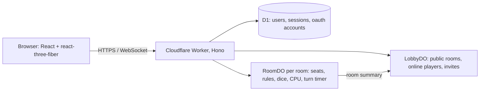

# Cờ cá ngựa 3D online

Status: delivered. Tracking issue: https://github.com/johnnybui1911/game-ca-ngua-online/issues/1 (holds the confirmed Done means, out of scope and constraints).

## Architecture

One Worker serves the built client (static assets, SPA fallback) and `/api/*`.
Local dev and e2e run through `vite` with `@cloudflare/vite-plugin` on port 5173.

## Shared contracts (owned by the orchestrator, read-only for pieces)

- `shared/game/types.ts`: board model, `GameState`, `GameEvent`, the rules text and the `RulesEngine` signature.
- `shared/protocol.ts`: HTTP bodies, room and lobby WebSocket messages, room code alphabet, seat-to-colour table.
- `worker/env.ts`, `wrangler.jsonc`, `vite.config.ts`, `tsconfig*.json`, `package.json`.

A piece that needs a contract change reports it instead of editing the file.

## Phases

| # | Piece | Owns | Depends on | Brief |
|---|---|---|---|---|
| 1 | Rules engine and CPU | `shared/game/**` except `types.ts` | none | [phase-01-rules.md](phase-01-rules.md) |
| 2 | Accounts: email + Google/Facebook/X | `worker/auth/**`, `migrations/**`, `web/src/**` app shell and auth pages, `e2e/auth*`, `e2e/mock-oauth*` | none | [phase-02-auth.md](phase-02-auth.md) |
| 3 | Rooms, lobby, invites, match HUD | `worker/rooms/**`, `web/src/lobby/**`, `web/src/room/**`, `e2e/room*` | 1, 2 | [phase-03-rooms.md](phase-03-rooms.md) |
| 4 | 3D scene | `web/src/scene/**`, `scene-dev.html` | 1 | [phase-04-scene.md](phase-04-scene.md) |
| 5 | Integration, CI, deploy, production checks, isolated review, merge | everything else | 1-4 | orchestrator |

Phases 1 and 2 run in parallel, then 3 and 4 in parallel.

## Acceptance

The eight Done-means items in issue #1, each verified by the orchestrator on the integrated branch and on production.
