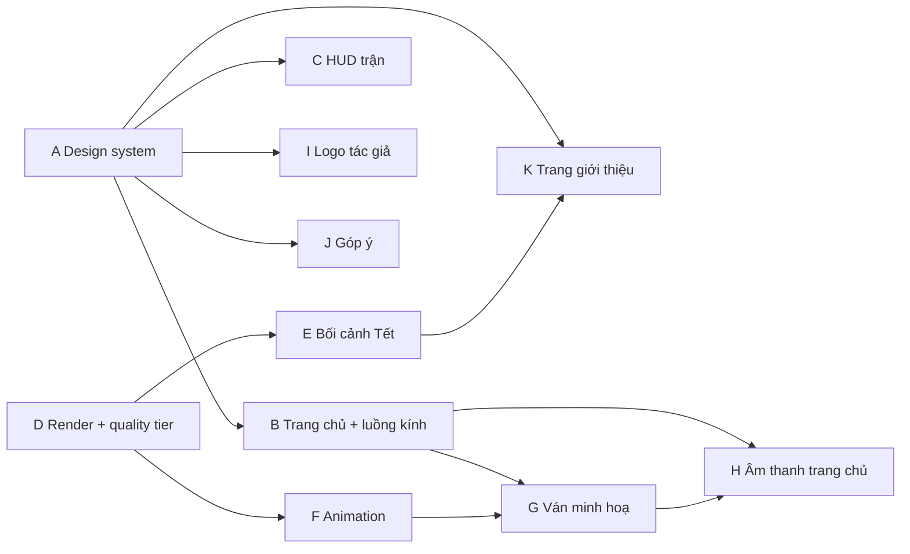

# Brainstorm: nâng cấp UI/UX Cờ Cá Ngựa 3D — tổng hợp đầu việc

Trạng thái: brainstorm xong, **chưa có plan**. Mỗi đầu việc dưới đây dự kiến thành một plan riêng.
Nguồn tham khảo: [20261121-xia-chess-tqd-ui-ux-comparison.md](./20261121-xia-chess-tqd-ui-ux-comparison.md).

## Quyết định đã chốt

| Mục | Quyết định |
| --- | --- |
| Bối cảnh 3D | Phòng khách đêm Tết, dựng kiểu sân khấu tối (chỉ dựng đồ gần bàn, xa chìm trong tối/sương) |
| Nguồn asset | Procedural (code) + 2–3 model CC0; không mua, không lấy asset của chess.tqd.me |
| Trang chủ `/` | Bàn cờ 3D toàn màn hình, nút "Chơi ngay" giữa-dưới trên tiền cảnh, không che bàn |
| Luồng vào game | Mọi bước (nhập tên → sảnh → phòng chờ) là tấm kính mờ trên nền bàn cờ đang chạy; bàn luôn nhìn thấy |
| Bàn ở trang chủ | Ngựa máy tự chơi minh hoạ, 4 màu, nhịp nhanh, chạy 100% trên trình duyệt |
| Dự phòng | Bàn trống xoay chậm cho máy yếu / `prefers-reduced-motion` / lúc đang tải |
| Khi mở form | Ván minh hoạ chậm lại, bớt cảnh lướt gần |
| Khi vào trận thật | Ngựa minh hoạ bay về chuồng rồi ván thật bắt đầu |
| Nhạc | Mặc định bật, phát ngay lần chạm đầu tiên (giới hạn trình duyệt), fade-in khi bấm "Chơi ngay" |
| Nút "Chơi ngay" | Đứng yên, nền tối riêng; vài giây đầu không có cảnh lướt gần; cảnh hành động đóng khung tránh vùng nút; dịu lại khi rê chuột gần |
| Trang giới thiệu | Giữ path riêng `/co-ca-ngua-online` (HTML tĩnh, SEO, FAQ JSON-LD), làm lại theo phong cách mới |

## Đầu việc

### A. Design system (nền móng cho mọi giao diện)
- Bảng màu tối ấm + màu nhấn kim loại; giữ 4 màu ngựa làm màu phe.
- Font self-host có subset tiếng Việt: Be Vietnam Pro (UI/body) + serif có dấu Việt cho tiêu đề; bỏ `Trebuchet MS`.
- Motion tokens (easing chuẩn, 0.18–0.25s), tôn trọng `prefers-reduced-motion`.
- Thành phần dùng chung: tấm kính mờ (có fallback nền đặc cho máy yếu), nút/pill, trạng thái active.
- Bộ icon SVG thống nhất thay emoji.
- File chính: `web/src/styles/tokens.css`, `base.css`, các CSS màn hình.
- Cỡ: M.

### B. Trang chủ + luồng vào game trên nền 3D
- Cảnh 3D thành layout gốc, sống xuyên suốt các route (không mount lại khi chuyển trang).
- `/` công khai (hiện bị `RequireAuth` đẩy sang `/bat-dau`), chỉ hỏi tên khi bấm "Chơi ngay".
- Scene cần chế độ không có ván (hiện `GameSceneProps.room.game` luôn bắt buộc).
- Camera chừa vùng nút "Chơi ngay" (tận dụng logic HUD inset có sẵn trong `camera.ts`); dịch bàn khi mở kính.
- Các màn nhập tên / sảnh / phòng chờ chuyển thành tấm kính overlay.
- Link mời `/r/:code`: bàn phía sau, kính nhập tên phía trên.
- Loading: ảnh tĩnh của bàn → cảnh 3D fade-in.
- Logo tác giả (trên phải), nút nhạc (dưới trái), chỗ đặt nút Góp ý (dưới phải).
- Cỡ: L.

### C. HUD trong trận + phòng chờ (restyle)
- Card người chơi, thanh lượt/đếm giờ/xúc xắc, nút Đổ xúc xắc, menu, dialog thắng theo design system mới.
- Giữ touch target 48px và layout responsive hiện có.
- Cỡ: M.

### D. Pipeline render + chất lượng tự động
- Ánh sáng môi trường (Lightformer/softbox), 3 điểm sáng, ACES tone mapping, bloom nhẹ, fog.
- Quality tier tự động (đo FPS, hạ DPR, tắt bloom/hạt/bóng theo tier); giữ nhánh software renderer hiện có.
- Dừng/giảm tốc vẽ khi tab ẩn hoặc kính che gần hết bàn.
- Phải xong trước khi thêm bối cảnh nặng.
- Cỡ: M.

### E. Bối cảnh phòng khách đêm Tết
- Sập gụ/bàn trà, đèn lồng đỏ phát sáng nhấp nháy, cành mai/đào, câu đối, mâm ngũ quả, sàn gạch, bụi bay.
- Procedural là chính + 2–3 model CC0; nén (meshopt + KTX2/webp), tổng asset mục tiêu < ~3 MB.
- Ghi lại nguồn + license từng asset.
- Cỡ: L (rủi ro lớn nhất về công sức).

### F. Animation ngựa + xúc xắc
- Ngựa nhảy từng ô theo đường cong, nén/giãn khi nhảy, nghiêng theo hướng đi.
- Đá ngựa: lấy đà → khựng hình (hit-stop) → văng về chuồng; camera lướt gần + rung nhẹ.
- Xúc xắc lăn có nảy rồi mới dừng.
- Mức hoạt cảnh (Đầy đủ / Giảm).
- File chính: `web/src/scene/director.ts`, `Pieces.tsx`.
- Cỡ: M–L.

### G. Ván minh hoạ trang chủ (attract mode)
- Bộ chạy trong trình duyệt dùng `shared/game/engine.ts` + `shared/game/cpu.ts`, sinh dữ liệu cùng định dạng batch để tái dùng animation.
- 4 màu, nhịp nhanh, hết ván tự chơi lại.
- Quy tắc camera bảo vệ nút "Chơi ngay"; chậm lại khi mở kính.
- Vào trận thật: ngựa minh hoạ bay về chuồng.
- Không gọi server, không gửi analytics cho nước đi minh hoạ.
- Nên làm sau F để khoe animation mới.
- Cỡ: M–L.

### H. Âm thanh trên trang chủ
- Nhạc phát ở lần chạm đầu, fade-in khi bấm "Chơi ngay"; giữ lựa chọn tắt nhạc đã lưu.
- Chính sách tiếng hiệu ứng của ván minh hoạ (chờ chốt).
- Kiểm tra iPhone khi gạt nút im lặng (Web Audio có thể bị tắt; thử `navigator.audioSession`).
- Cỡ: S (có thể gộp vào B hoặc G).

### I. Logo tác giả
- Card nhỏ góc trên phải, cả desktop và mobile.
- Cần asset từ anh: PNG nền trong hoặc SVG, vuông ≥ 256px, tên hiển thị, link (tuỳ chọn).
- Cỡ: S.

### J. Góp ý / Đề xuất
- FAB góc dưới phải + modal: hạng mục, tên/liên hệ (tuỳ chọn), nội dung (bắt buộc), tự kèm thiết bị và mã phòng nếu có.
- Worker endpoint + bảng D1 mới + rate-limit theo pattern `auth_attempts`, giới hạn độ dài, không render HTML.
- Cỡ: M.

### K. Trang giới thiệu `/co-ca-ngua-online`
- Giữ nguyên nội dung chữ, canonical, sitemap, JSON-LD (VideoGame, FAQPage).
- Phong cách mới; hero là video lặp ngắn hoặc ảnh render từ cảnh 3D mới (không tải three.js).
- Nền ảnh bàn cờ cố định, các section là kính mờ cuộn qua.
- Ảnh minh hoạ luật bằng render; CTA về `/`.
- Cần ảnh/video từ E (+ F để đẹp hơn).
- Cỡ: M.

## Phụ thuộc

Đợt gợi ý:
1. A, D, phần backend của J (song song).
2. B, C, E, F, I.
3. G, H, K.

## Điểm nóng khi chia agent song song

| File / vùng | Bị đụng bởi | Gợi ý |
| --- | --- | --- |
| `web/src/styles/tokens.css` | A, B, C, J, K | A sở hữu; các plan khác chỉ dùng token |
| `web/src/scene/camera.ts` | B (vùng nút), F (lướt gần khi đá), G (camera minh hoạ) | Một chủ sở hữu, các plan khác thống nhất interface trước |
| `web/src/scene/GameScene.tsx` | B (layout gốc, chế độ không ván), D (render config) | Làm tuần tự hoặc chốt contract props trước |
| `web/src/scene/director.ts` | F, G | F trước, G dùng lại |
| `web/src/App.tsx`, `RequireAuth.tsx` | B | Chỉ B |

## Còn chờ anh chốt

1. Tiếng hiệu ứng của ván minh hoạ khi đang mở form: tắt, nhỏ, hay giữ nguyên?
2. File logo + tên hiển thị + link.
3. Font tiêu đề (Playfair Display hay Noto Serif Display) — nên xem bản preview trong plan A.
4. Màu nhấn chính: vàng đồng hay đỏ son + vàng (hợp Tết)?
5. Bộ icon: thư viện có sẵn (Lucide/Phosphor) hay vẽ riêng?
6. Góp ý: anh muốn đọc ở đâu (D1 console, trang admin, hay báo về email/chat)? Có cần đính kèm ảnh chụp màn hình?

## Ngoài phạm vi (chưa yêu cầu)
- Thay ngựa bằng model điêu khắc / có khung xương.
- PWA, cài ứng dụng.
- Đổi domain.
